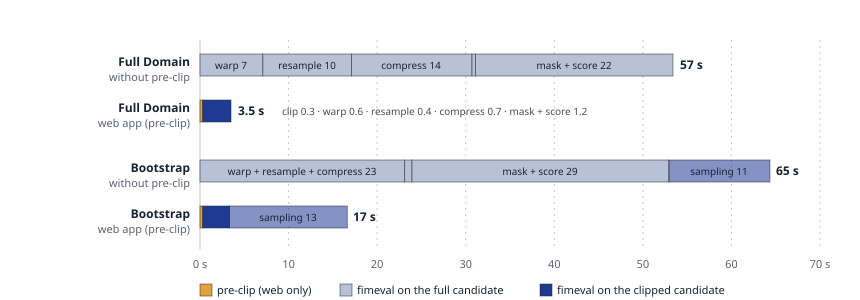

# Web app vs Desktop app: why the web evaluation is faster — FIMEVAL-BE50

**Question (Dinuke, Nathan, Reshma; demo of 2026-10-22):** a FIMeval web-app evaluation
finishes in seconds where the desktop app takes minutes. Are results cached? Is the web
app skipping a step the desktop app performs? If not, what does it do differently, so the
fimeval authors can benefit?

**Answer in three lines.**
1. Nothing is cached and nothing is skipped: both apps call the same `fimeval.EvaluateFIM`,
   and every one of the 17 whole-domain metrics is bit-for-bit identical across all
   configurations measured here.
2. The web app is faster for one reason: before calling fimeval it **clips each candidate
   raster to the benchmark's extent (plus a 5 % buffer)** (FIMEVAL-BE31, worker
   `_clip_candidates_to_benchmark`). On the test case that turns a 304-megapixel candidate
   into a 4.9-megapixel one, so every later fimeval phase does ~20× less work:
   **57 s → 3.5 s and 4.6 GB → 0.55 GB** for Intersected Extent.
3. Everything else (warm worker, no upload on re-evaluate, local MinIO, newer fimeval,
   `PROJ_NETWORK=OFF`) is worth a few seconds at most on this case.

**Date:** 2026-10-29 · WSL2, 15.6 GiB, **shared with a running LISFLOOD-FP model** (load
average 4–11 throughout, see Caveats) · fimeval **0.1.64** (web) and **0.1.62** (the wheel
in the desktop repo's `dist/`) · harness `be50-profile-harness.py`, raw results
`be50-profile-results.jsonl` (both next to this file).

---

## 1. What each app actually runs

Both apps are thin wrappers around the same library call. The differences are in what
they pass and what they do before the call.

| | Web app (worker `evaluate_fim.py`) | Desktop app (`fimpef_final/gui.py`) |
|---|---|---|
| Library | fimeval 0.1.64 (pinned ≥ 0.1.64) | fimeval 0.1.62 (bundled) |
| Before `EvaluateFIM` | download inputs from MinIO to a temp dir; **pre-clip candidates to benchmark extent + 5 %** (BE31) | none (reads the user's folder in place) |
| `target_crs` | `EPSG:5070` | `EPSG:5070` (default field) |
| `target_resolution` | not passed → coarsest input resolution | **10 m** (default field) |
| Permanent water bodies | ArcGIS fetch (no `PWB_dir`) | ArcGIS fetch unless the user gives a `PWB_dir` |
| Bootstrap defaults | stratified, 100 × 500, no seed | **random, seed 42**, 100 × 500 |
| `plot_metrics` | `False` (plots are drawn in the browser from the CSV) | **`True`** (writes PNGs with matplotlib) |
| Process | long-lived Dask worker (imports already loaded) | one GUI process, imports loaded once per app launch |
| PROJ grids | `PROJ_NETWORK=OFF` (BE28) | PROJ default (off unless configured) |
| Concurrency | bounded pool, 2 workers | strictly one job at a time |

Configurations replayed by the harness (all on the same Tier_2 case study: a 2.3 MB PSS
benchmark at ~10 m in UTM 18N, 1756 × 2492 px, and the 4.8 MB OWP HAND FIM candidate
covering the whole HAND domain, 23 234 × 13 108 px at 10 m in EPSG:5070):

| Config | Means |
|---|---|
| **A** | the web worker today: 0.1.64, pre-clip, web kwargs |
| **A0** | A without the pre-clip (isolates BE31 exactly) |
| **B** | desktop kwargs (res = 10 m, random + seed 42, plots) on 0.1.64, no pre-clip |
| **B2** | B with `plot_metrics=False` (isolates plotting) |
| **C** | the desktop app as shipped: B's kwargs on fimeval 0.1.62 |

"Full Domain" in the web UI is the Intersected Extent method; the bootstrap runs use each
app's default sampling approach. The desktop GUI itself is a macOS/Windows bundle that does
not run here, so C replays its exact `EvaluateFIM` call on the 0.1.62 wheel, the same
method PERF-3 used in July.

## 2. Per-phase timings




Seconds, one run each unless noted; peak RSS of the process in MB. Phases are measured by
wrapping the functions fimeval itself calls (`MakeFIMsUniform` with its reproject /
resample / LZW-compress steps, `ExtractPWB`, `evaluateFIM`, `run_bootstrap`); "mask +
metrics" is the remainder of `evaluateFIM`.

### Intersected Extent ("Full Domain")

| Config | run | import | pre-clip | uniform (warp / resample / compress) | PWB fetch | mask + metrics | **wall** | **peak RSS** |
|---|---|--:|--:|--:|--:|--:|--:|--:|
| **A web** | cold | 13.5* | 0.30 | 1.38 (0.56 / 0.42 / 0.73) | 0.42 | 1.22 | **3.5** | **553** |
| **A web** | warm | – | 0.15 | 1.13 (0.42 / 0.38 / 0.60) | 0.20 | 0.95 | **2.4** | **553** |
| A0 (no pre-clip) | cold | 2.7 | – | 23.8 (7.1 / 10.0 / 13.6) | 0.36 | 22.3 | 56.8 | 4 632 |
| B desktop kwargs | cold | 2.3 | – | 23.5 (7.2 / 8.7 / 14.6) | 1.56 | 48.7 | 73.9 | 4 632 |
| B desktop kwargs | warm | – | – | 20.4 (6.1 / 7.8 / 12.4) | 0.46 | 34.6 | 55.8 | 4 632 |
| C desktop (0.1.62) | cold | 2.4 | – | 23.7 (7.6 / 9.2 / 14.2) | 1.12 | 152.2† | 177.3† | 4 629 |

\* first import after a cold disk cache; every later process imported in 2.3–3.1 s.
† measured at load average 11; see Caveats.

### Bootstrap

| Config | run | pre-clip | uniform | PWB | mask + metrics | bootstrap sampling | PNGs | **wall** | **peak RSS** |
|---|---|--:|--:|--:|--:|--:|--:|--:|--:|
| **A web** (stratified) | cold | 0.31 | 1.45 | 0.36 | 1.21 | 13.3 | 0 | **16.9** | **750** |
| **A web** (stratified) | warm | 0.17 | 1.21 | 0.33 | 0.92 | 12.1 | 0 | **14.7** | **756** |
| **A web** (stratified) | cold, repeat | 0.20 | 1.29 | 0.40 | 1.05 | 12.4 | 0 | **15.7** | **749** |
| A0 (no pre-clip, stratified) | cold | – | 23.1 | 0.84 | 29.0 | 11.4 | 0 | 64.6 | 4 632 |
| B2 desktop kwargs, no plots (random) | cold | – | 22.4 | 0.44 | 23.6 | 2.5 | 0 | 52.6 | 4 632 |
| B desktop kwargs (random + plots) | cold | – | 22.3 | 1.09 | 62.0 | 12.3 | 1 | 98.0 | 4 631 |
| C desktop (0.1.62, random + plots) | cold | – | 23.2 | 0.38 | 19.4 | 10.3 | 1 | 55.2 | 4 631 |

Transfer legs of the web path, measured through the app's own storage client against the
dev MinIO: the 7.1 MB of inputs upload in 0.8 s and the worker downloads them in 0.03 s.
Output upload is a handful of small files. On the CIROH deployment these legs are
network-bound and will dominate for large inputs, but they are not what makes a run fast.

## 3. Findings

### F1 — The pre-clip is the whole difference (A vs A0)

Same library, same arguments, same outputs; the only change is cutting the candidate to
the benchmark's footprint before fimeval sees it. Every downstream phase shrinks by the
same factor as the pixel count (304 Mpx → 4.9 Mpx): warp 7.1 → 0.56 s, resample 10.0 →
0.42 s, LZW compress 13.6 → 0.73 s, mask + metrics 22.3 → 1.22 s. Peak memory drops from
4.6 GB to 0.55 GB because the full-resolution warp intermediate (the PERF-2 memory
ceiling) is now a small raster. The pre-clip itself costs 0.15–0.3 s.

This is why the "runs in seconds" impression is real: a HAND FIM candidate always covers
far more area than the benchmark it is scored against, and fimeval warps, resamples and
compresses the whole thing before masking it down to the benchmark.

### F2 — Nothing is skipped: outputs are identical

All 17 rows of `EvaluationMetrics.csv` (CSI, TP/FP/FN/TN, POD, FAR, F1, MCC, kappa, …)
are identical to the last digit across A, A0, B, B2 and C, on both methods. The clip
cannot change the result because fimeval only ever scores the benchmark ∩ candidate
area, and the 5 % buffer keeps every pixel that area can contain. The output folders
match file for file (boundary shapefile, masked FIMs, contingency map, metrics CSV,
bootstrap CSV) except for the one thing the web app deliberately does not do inside
fimeval: write plot PNGs (`plot_metrics`). The browser draws the box plots from the
bootstrap CSV instead (FE60).

### F3 — The other differences are small on this case

- **Warm worker:** 2.4 s vs 3.5 s for Intersected Extent, 14.7 vs 15.7–16.9 s for
  bootstrap. Plus the import itself, 2.3–3.1 s per fresh process (13.5 s once, after a
  cold disk cache). The desktop app pays the import once per launch too.
- **Re-evaluate skips the upload**, but on local MinIO the upload is under a second.
- **`target_resolution=10`** (desktop default) changes nothing here because 10 m is
  already the coarsest input; PERF-3 found it saves no memory on any case.
- **Sampling approach:** the web default *stratified* costs ~12 s of sampling against
  ~2.5 s for the desktop default *random* (B2). The desktop's `seed=42` has no cost.
- **`plot_metrics=True`** adds roughly 10 s (B vs B2, one PNG) and, headless, requires a
  non-interactive matplotlib backend: the first replay crashed trying to open a Qt window.
- **fimeval 0.1.62 vs 0.1.64:** PERF-3 measured 0.1.62 at +1.2 GB and 2× slower on
  bootstrap. C's Intersected Extent run here (152 s in mask + metrics) landed during the
  heaviest machine load and should not be quoted as a version cost.

## 4. For the fimeval team (what the web app does that fimeval could do)

1. **Clip candidates to the benchmark extent (+ buffer) before `MakeFIMsUniform`.** The
   worker's version is ~40 lines on rasterio windows (`_clip_candidates_to_benchmark` in
   `tethysapp/fimeval_gui/job_types/evaluate_fim.py`): transform the benchmark bounds into
   each candidate's CRS, window-read, write back with the same profile. It is metric-safe
   and gives ~20× on wall time and ~8× on memory for whole-domain candidates. Also drops
   non-overlapping candidates with a clear message instead of a late failure.
2. **Warp and resample in one pass to the final grid** (PERF-2): fimeval warps at native
   resolution and then resamples down, so the expensive work is done on pixels that are
   thrown away. Combined with (1) it would also remove the full-resolution intermediate
   that sets peak memory.
3. **Ship ≥ 0.1.64** in the desktop bundle (PERF-3).
4. Document that stratified sampling is ~5× the cost of random on the sampling step.

## 5. Caveats

- The machine was shared with a running LISFLOOD-FP model for the whole session (load
  average 4–11). Web-config numbers are sub-second-stable across repeats; the
  desktop-style cells (A0, B, B2, C) vary ±2× between runs of identical code (B cold 48.7
  s vs warm 34.6 s vs A0 22.3 s for the same mask + metrics phase). Compare phases and
  orders of magnitude, not single seconds. A quiet re-run of A0/B/C is cheap if exact
  desktop-side numbers are wanted (`be50-profile-harness.py`).
- The desktop GUI was replayed, not driven (it is a macOS/Windows bundle). Its 0.1.62
  code ran on the tethys env's dependency stack, as in PERF-3.
- One case study (Tier_2). The pre-clip factor scales with candidate area ÷ benchmark
  area; BE31's live validation on a 300 Mpx candidate measured 8.5× on peak memory with an
  identical CSI.

## Appendix — reproduce

```bash
conda activate tethys && cd ~/tethysdev/tethysapp-fimeval-gui
H=docs/specs/be50-profile-harness.py; D=~/random/fimeval-notebook/FIMeval/Tier_2
python -I -c "import sys; sys.path.insert(0,'.'); sys.argv=['x','--config','A','--method','intersected_extent','--data','$D','--out','r.jsonl']; exec(open('$H').read())"
# desktop as shipped: pip install --no-deps --target /tmp/f062 ~/random/FIMeval/fimpef_final/dist/fimeval-0.1.62-py3-none-any.whl
#   then PYTHONPATH=/tmp/f062 MPLBACKEND=Agg … --config C
```
